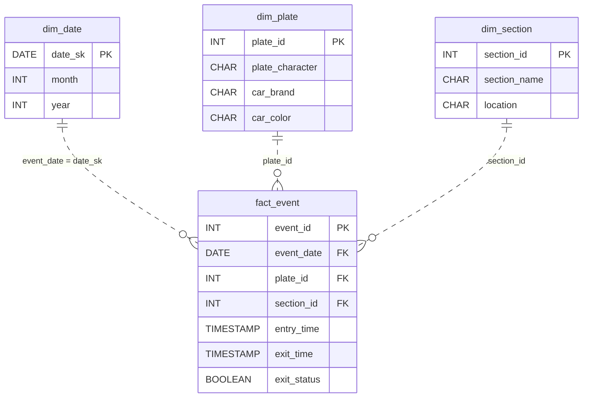

# Between the Cameras

*Every plate that goes in should come out. Watch the ones that don't.*

[Data Modeling · Easy · on DataDriven](https://datadriven.io/problems/between_the_cameras)

## How it went

| | |
|---|---|
| Solved | 2026-10-27 |
| Accepted | on the first submission |
| Hints | none |
| Concepts | Attributes, Constraints, Data Types, Entities, Foreign Keys, Grain Definition, One-to-Many, Pre-Aggregation, Primary Keys |

## The design

The accepted design is in [`schema.sql`](./schema.sql) as DDL and in [`schema.json`](./schema.json) as JSON.
