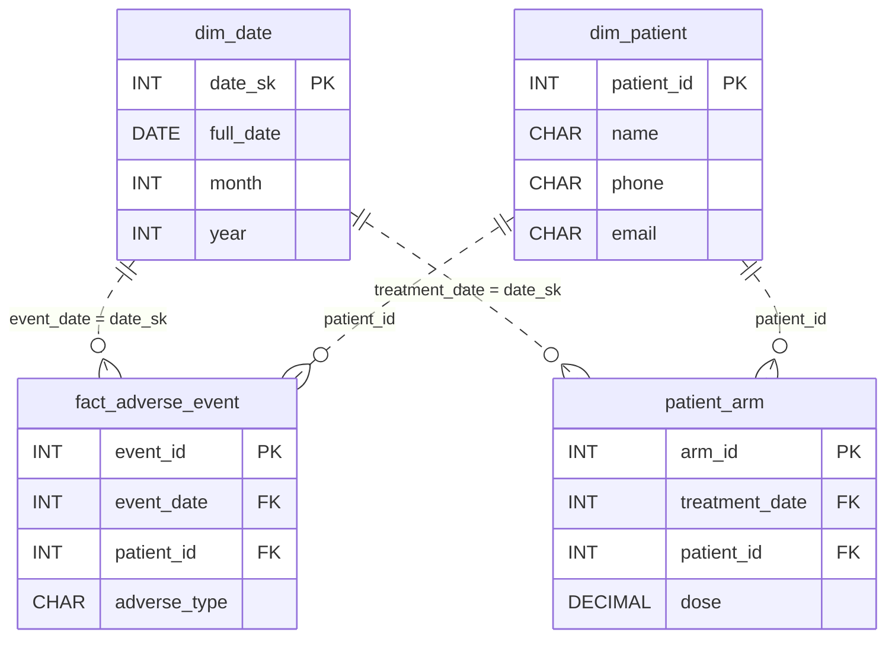

# Crossing Over

[Data Modeling · Medium · on DataDriven](https://datadriven.io/problems/crossing_over)

## How it went

| | |
|---|---|
| Solved | 2026-10-16 |
| Accepted | on the 2nd submission |
| Hints | none |
| Concepts | Constraints, Dimension Tables, Fact Tables, Foreign Keys, Grain Definition, Junction Tables, Many-to-Many, One-to-Many, Primary Keys, SCD Strategy, SCD Type 2, Star Schema, Surrogate Keys |

## The design

The accepted design is in [`schema.sql`](./schema.sql) as DDL and in [`schema.json`](./schema.json) as JSON.
