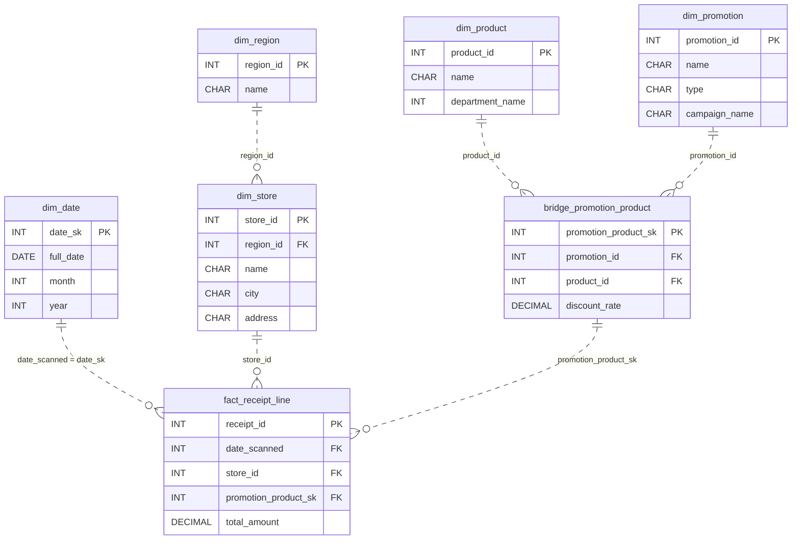

# Every Line Counts

*Every beep at the register. Coupons, returns, all of it.*

[Data Modeling · Medium · on DataDriven](https://datadriven.io/problems/every_line_counts)

## How it went

| | |
|---|---|
| Solved | 2026-10-12 |
| Accepted | on the first submission |
| Hints | none |
| Concepts | Dimension Tables, Fact Tables, Foreign Keys, Junction Tables, Many-to-Many, One-to-Many, Primary Keys, Star Schema, Surrogate Keys |

## The design

The accepted design is in [`schema.sql`](./schema.sql) as DDL and in [`schema.json`](./schema.json) as JSON.
