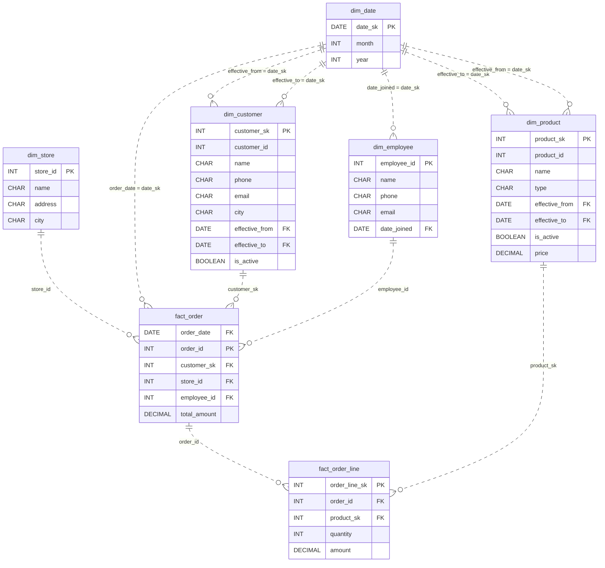

# Every Line Remembered

*Customers move, products relaunch, and some stores have no address. Reshape the tables so nothing gets forgotten.*

[Data Modeling · Medium · on DataDriven](https://datadriven.io/problems/every_line_remembered)

## How it went

| | |
|---|---|
| Solved | 2026-10-31 |
| Accepted | on the first submission |
| Hints | none |
| Concepts | Attributes, Denormalization, Dimension Tables, Entities, Fact Tables, Foreign Keys, Grain Definition, Metric Additivity, One-to-Many, Primary Keys, Star Schema, Surrogate Keys |

## The design

The accepted design is in [`schema.sql`](./schema.sql) as DDL and in [`schema.json`](./schema.json) as JSON.
