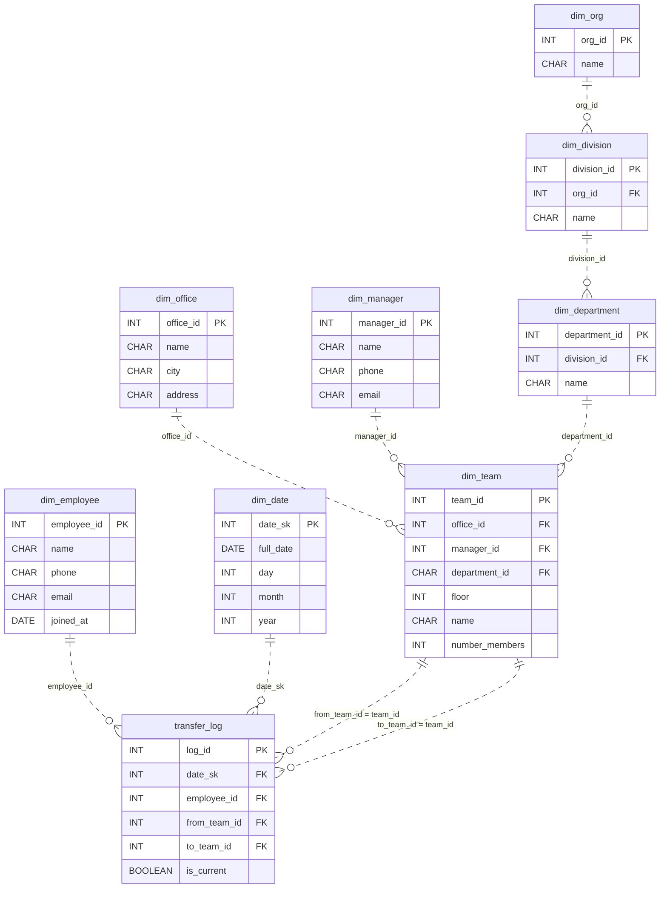

# Lateral Paths

*People switch teams. HR loses track.*

[Data Modeling · Medium · on DataDriven](https://datadriven.io/problems/lateral_paths)

## How it went

| | |
|---|---|
| Solved | 2026-10-12 |
| Accepted | on the 2nd submission |
| Hints | none |
| Concepts | Attributes, Composite Keys, Constraints, Data Types, Entities, Foreign Keys, Grain Definition, Junction Tables, Many-to-Many, One-to-Many, Primary Keys, SCD Type 2, Surrogate Keys |

## The design

The accepted design is in [`schema.sql`](./schema.sql) as DDL and in [`schema.json`](./schema.json) as JSON.
