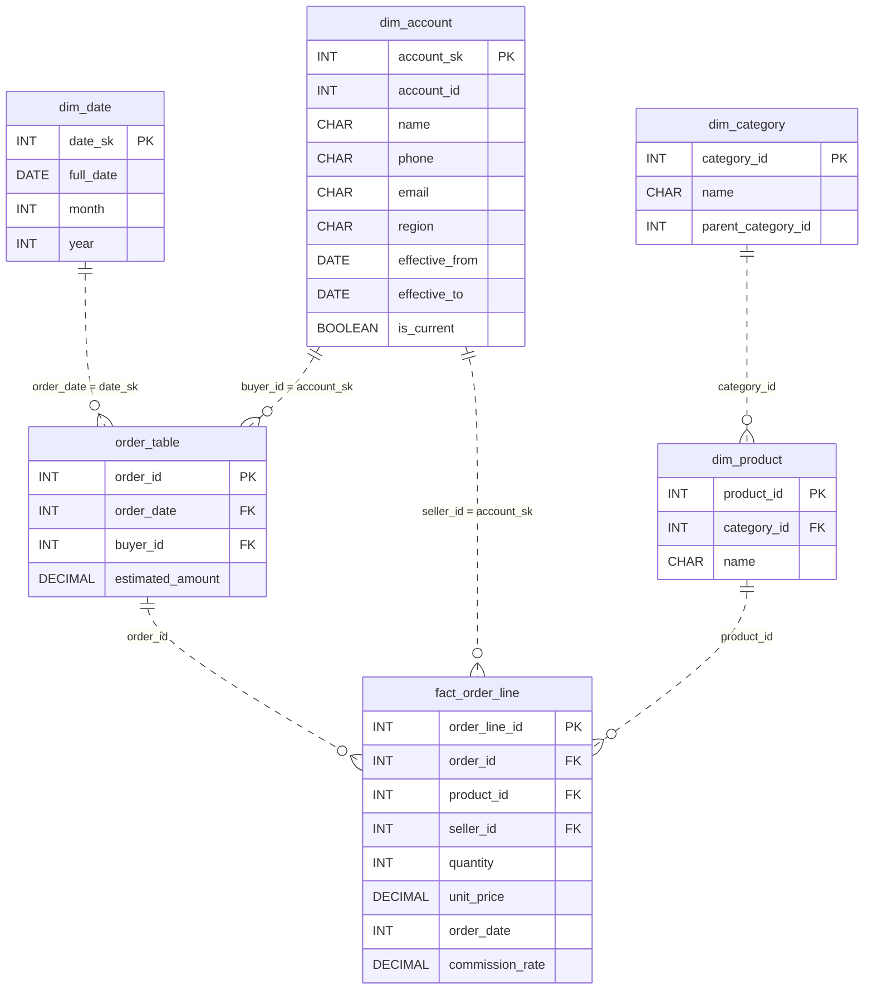

# Marketplace Sales Warehouse

*No schema given. The interviewer is watching.*

[Data Modeling · Hard · on DataDriven](https://datadriven.io/problems/marketplace_sales_warehouse)

## How it went

| | |
|---|---|
| Solved | 2026-10-16 |
| Accepted | on the 3rd submission |
| Hints | none |
| Concepts | Denormalization, Dimension Tables, Fact Tables, Foreign Keys, Grain Definition, Metric Additivity, One-to-Many, Primary Keys, Snowflake Schema, Surrogate Keys |

## The design

The accepted design is in [`schema.sql`](./schema.sql) as DDL and in [`schema.json`](./schema.json) as JSON.
