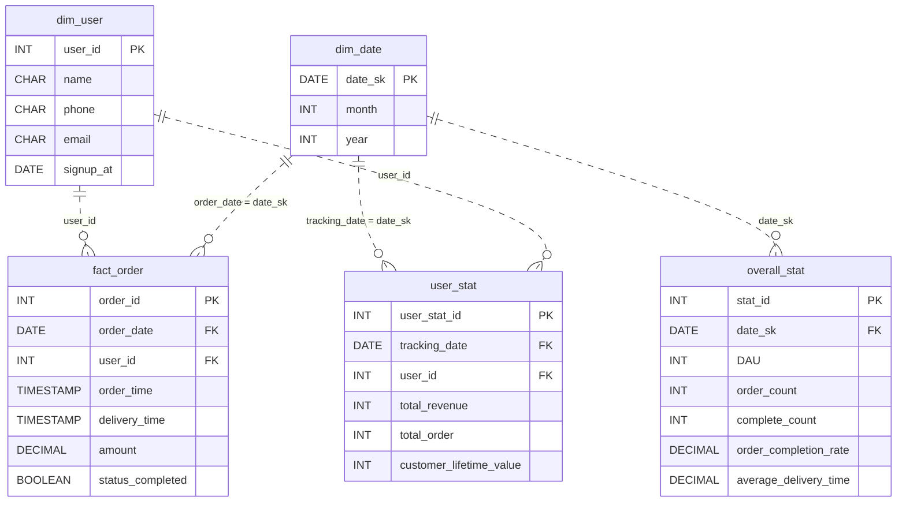

# Metric Definition Reverse Engineering

*Five numbers on a dashboard. Your job: figure out where they come from.*

[Data Modeling · Hard · on DataDriven](https://datadriven.io/problems/metric_definition_reverse_engineering)

## How it went

| | |
|---|---|
| Solved | 2026-10-29 |
| Accepted | on the first submission |
| Hints | none |
| Concepts | Attributes, Denormalization, Dimension Tables, Event Sourcing, Fact Tables, Foreign Keys, Grain Definition, Metric Additivity, One-to-Many, Pre-Aggregation, Primary Keys, Surrogate Keys |

## The design

The accepted design is in [`schema.sql`](./schema.sql) as DDL and in [`schema.json`](./schema.json) as JSON.
