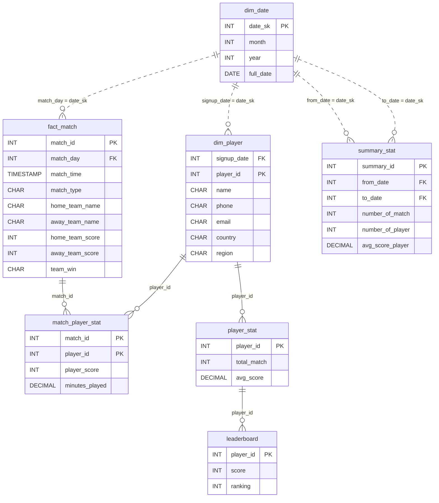

# Multiplayer Game Match History

*Millions of matches. The leaderboard refreshes in 15 minutes.*

[Data Modeling · Medium · on DataDriven](https://datadriven.io/problems/multiplayer_game_match_history)

## How it went

| | |
|---|---|
| Solved | 2026-11-11 |
| Accepted | on the first submission |
| Hints | none |
| Concepts | Attributes, Dimension Tables, Entities, Fact Tables, Foreign Keys, Grain Definition, Many-to-Many, Metric Additivity, One-to-Many, Pre-Aggregation, Primary Keys, Star Schema, Surrogate Keys |

## The design

The accepted design is in [`schema.sql`](./schema.sql) as DDL and in [`schema.json`](./schema.json) as JSON.
