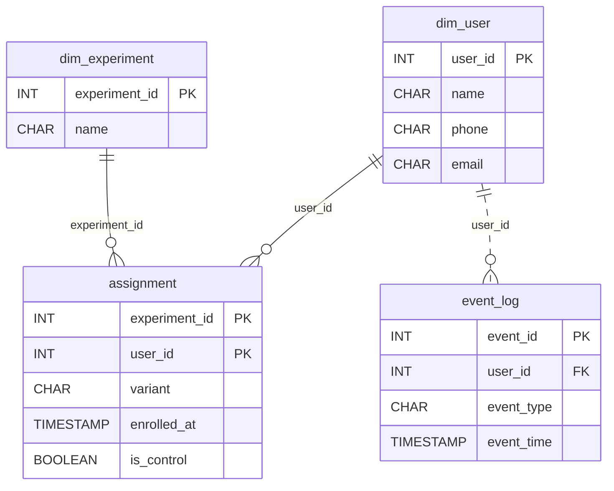

# One Door Each

*Every user picks a lane and stays in it. Model the world so the numbers stay honest.*

[Data Modeling · Medium · on DataDriven](https://datadriven.io/problems/one_door_each)

## How it went

| | |
|---|---|
| Solved | 2026-10-19 |
| Accepted | on the 4th submission |
| Hints | none |
| Concepts | Attributes, Cardinality, Composite Keys, Constraints, Dimension Tables, Entities, Fact Tables, Foreign Keys, Grain Definition, Immutable Logs, Junction Tables, Many-to-Many, Metric Additivity, One-to-Many, Primary Keys, Semantic Layer, Star Schema, Surrogate Keys |

## The design

The accepted design is in [`schema.sql`](./schema.sql) as DDL and in [`schema.json`](./schema.json) as JSON.
