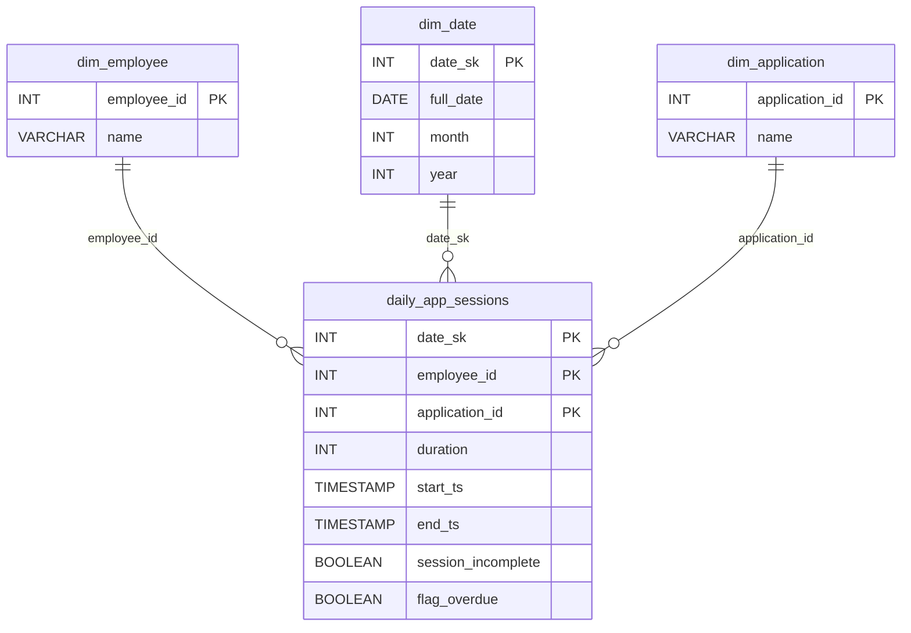

# Open Threads

*Every minute tracked. Every app accounted for.*

[Data Modeling · Medium · on DataDriven](https://datadriven.io/problems/open_threads)

## How it went

| | |
|---|---|
| Solved | 2026-10-13 |
| Accepted | on the first submission |
| Hints | none |
| Concepts | Cardinality, Data Types, Dimension Tables, Entities, Event Sourcing, Fact Tables, Foreign Keys, Grain Definition, Immutable Logs, Late-Arriving Data, Many-to-Many, One-to-Many, Pre-Aggregation, Primary Keys, Star Schema, Surrogate Keys |

## The design

The accepted design is in [`schema.sql`](./schema.sql) as DDL and in [`schema.json`](./schema.json) as JSON.
