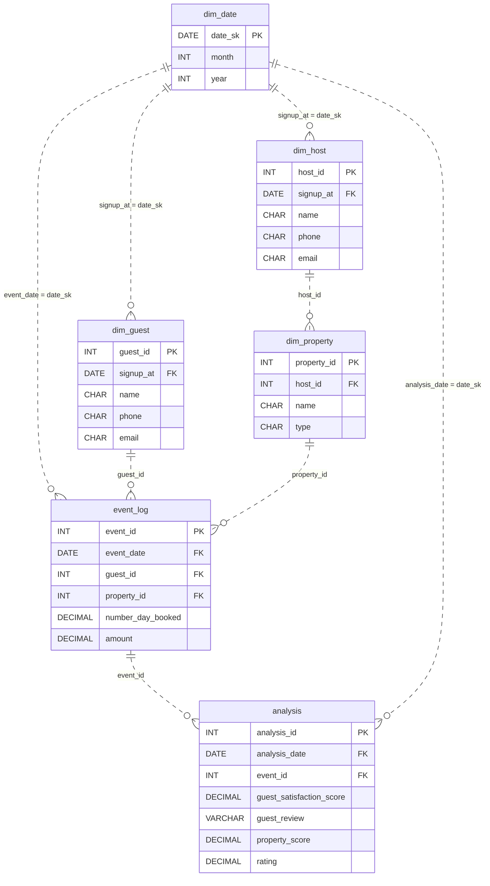

# Property Booking Platform

*Five-star listing. Three-star reality.*

[Data Modeling · Hard · on DataDriven](https://datadriven.io/problems/property_booking_platform)

## How it went

| | |
|---|---|
| Solved | 2026-10-28 |
| Accepted | on the first submission |
| Hints | none |
| Concepts | Attributes, Composite Keys, Constraints, Data Types, Denormalization, Dimension Tables, Fact Tables, Foreign Keys, Grain Definition, Indexing, Junction Tables, Key Generation, Many-to-Many, Metric Additivity, One-to-Many, Pre-Aggregation, Primary Keys, SCD Strategy, SCD Type 2, Star Schema, Surrogate Keys |

## The design

The accepted design is in [`schema.sql`](./schema.sql) as DDL and in [`schema.json`](./schema.json) as JSON.
