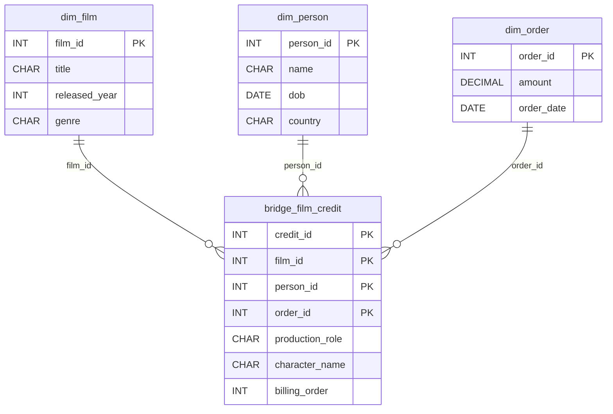

# The Credits Roll

*Searchable from every angle. Design it so nothing gets lost.*

[Data Modeling · Hard · on DataDriven](https://datadriven.io/problems/the_credits_roll)

## How it went

| | |
|---|---|
| Solved | 2026-10-12 |
| Accepted | on the 2nd submission |
| Hints | none |
| Concepts | Attributes, Constraints, Data Types, Entities, 1NF, Foreign Keys, Junction Tables, Many-to-Many, Primary Keys, 2NF, Surrogate Keys, 3NF |

## The design

The accepted design is in [`schema.sql`](./schema.sql) as DDL and in [`schema.json`](./schema.json) as JSON.
