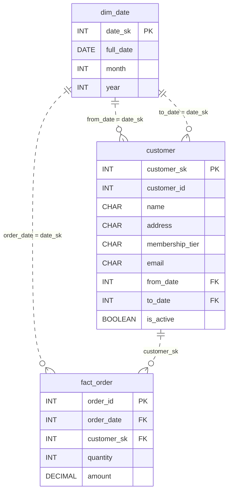

# The Customer Who Changed

*She moved. She upgraded. She became someone new. The record has to keep up.*

[Data Modeling · Hard · on DataDriven](https://datadriven.io/problems/the_customer_who_changed)

## How it went

| | |
|---|---|
| Solved | 2026-05-25 |
| Accepted | on the 5th submission |
| Hints | none |
| Concepts | Dimension Tables, Fact Tables, Foreign Keys, Indexing, Primary Keys, SCD Strategy, SCD Type 2, Surrogate Keys |

## The design

The accepted design is in [`schema.sql`](./schema.sql) as DDL and in [`schema.json`](./schema.json) as JSON.
