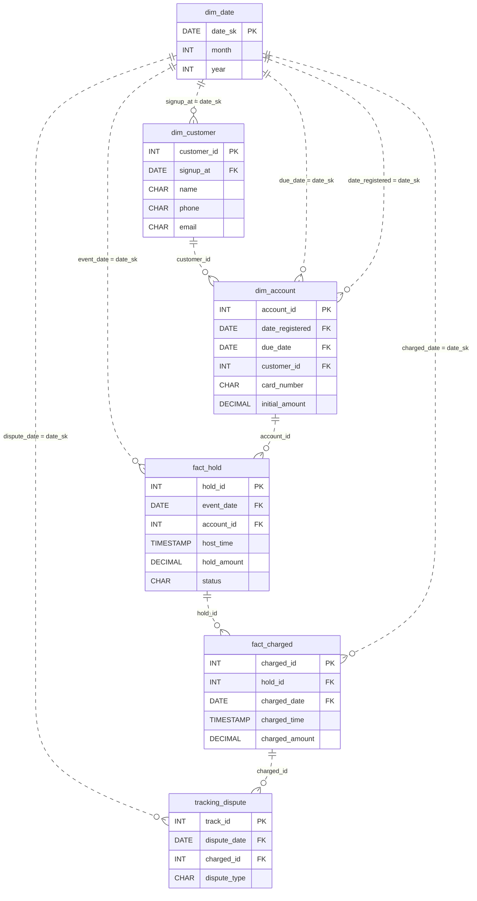

# The Float

[Data Modeling · Medium · on DataDriven](https://datadriven.io/problems/the_float)

## How it went

| | |
|---|---|
| Solved | 2026-10-27 |
| Accepted | on the 5th submission |
| Hints | 3 hints |
| Concepts | Attributes, Constraints, Data Types, Dimension Tables, Entities, Fact Tables, Foreign Keys, Grain Definition, Many-to-Many, Metric Additivity, One-to-Many, Pre-Aggregation, Primary Keys, Star Schema, Surrogate Keys |

## The design

The accepted design is in [`schema.sql`](./schema.sql) as DDL and in [`schema.json`](./schema.json) as JSON.
