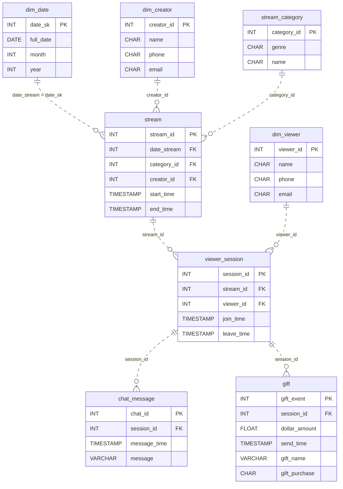

# The Gift Economy

*Someone goes live, thousands tune in, chat explodes, and virtual gifts start flying.*

[Data Modeling · Medium · on DataDriven](https://datadriven.io/problems/the_gift_economy)

## How it went

| | |
|---|---|
| Solved | 2026-10-16 |
| Accepted | on the 2nd submission |
| Hints | none |
| Concepts | Attributes, Cardinality, Constraints, Data Types, Dimension Tables, Entities, Fact Tables, 1NF, Foreign Keys, Grain Definition, Junction Tables, Many-to-Many, One-to-Many, Primary Keys, 2NF, Star Schema, 3NF |

## The design

The accepted design is in [`schema.sql`](./schema.sql) as DDL and in [`schema.json`](./schema.json) as JSON.
