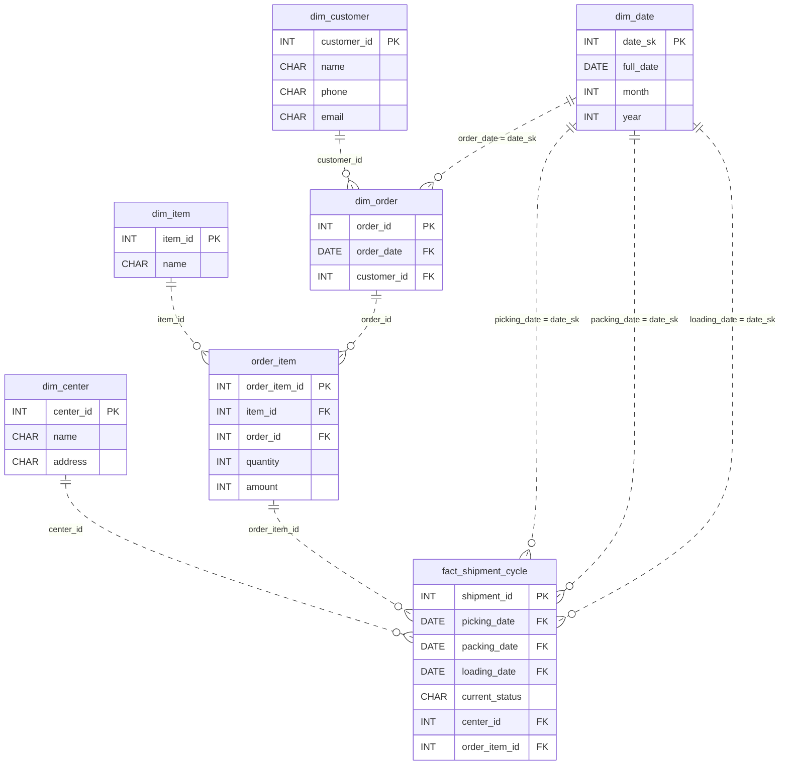

# The Long Route

*A package splits, reroutes, and (maybe) arrives.*

[Data Modeling · Hard · on DataDriven](https://datadriven.io/problems/the_long_route)

## How it went

| | |
|---|---|
| Solved | 2026-10-13 |
| Accepted | on the first submission |
| Hints | none |
| Concepts | Attributes, Cardinality, Composite Keys, Constraints, Entities, Event Sourcing, 1NF, Foreign Keys, Grain Definition, Immutable Logs, Junction Tables, Late-Arriving Data, Many-to-Many, One-to-Many, Primary Keys, 2NF, Surrogate Keys, 3NF |

## The design

The accepted design is in [`schema.sql`](./schema.sql) as DDL and in [`schema.json`](./schema.json) as JSON.
