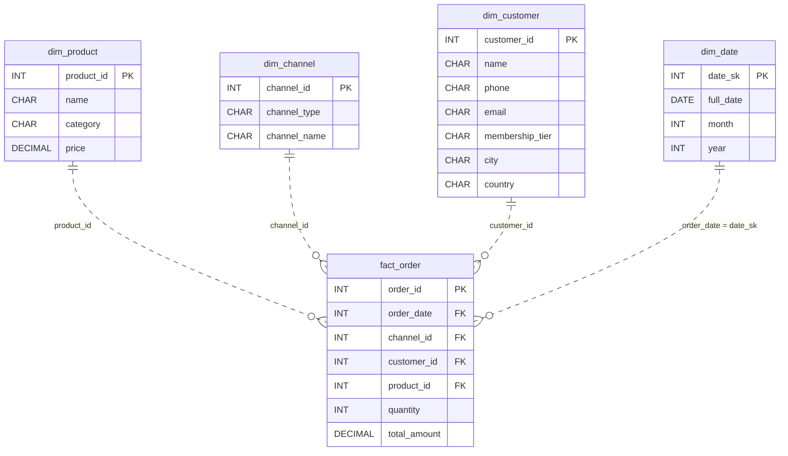

# The Retail Blueprint

*One business. A thousand transactions. Only one layout survives the analytics layer.*

[Data Modeling · Medium · on DataDriven](https://datadriven.io/problems/the_retail_blueprint)

## How it went

| | |
|---|---|
| Solved | 2026-11-10 |
| Accepted | on the first submission |
| Hints | none |
| Concepts | Denormalization, Dimension Tables, Fact Tables, Foreign Keys, Grain Definition, Metric Additivity, One-to-Many, Primary Keys, Star Schema, Surrogate Keys |

## The design

The accepted design is in [`schema.sql`](./schema.sql) as DDL and in [`schema.json`](./schema.json) as JSON.
