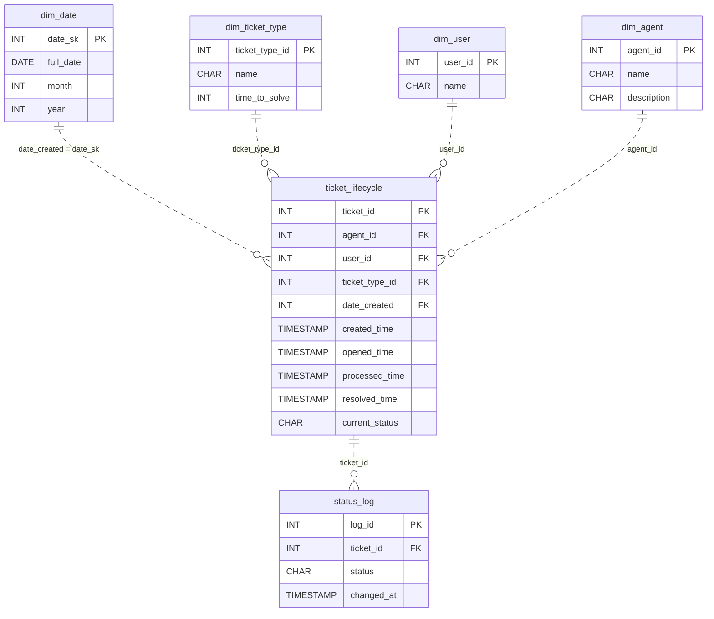

# The Vanishing State

*A status column forgets the moment it changes. Model the schema that remembers.*

[Data Modeling · Easy · on DataDriven](https://datadriven.io/problems/the_vanishing_state)

## How it went

| | |
|---|---|
| Solved | 2026-10-13 |
| Accepted | on the 4th submission |
| Hints | none |
| Concepts | Attributes, Cardinality, Constraints, Data Types, Entities, Event Sourcing, 1NF, Foreign Keys, Grain Definition, Immutable Logs, Metric Additivity, One-to-Many, Primary Keys, 2NF, Surrogate Keys, 3NF |

## The design

The accepted design is in [`schema.sql`](./schema.sql) as DDL and in [`schema.json`](./schema.json) as JSON.
