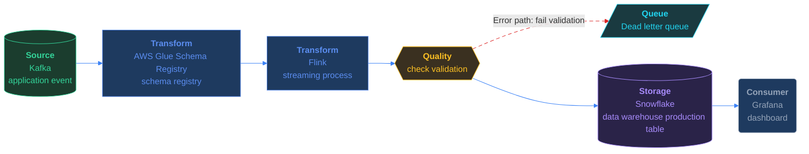

# The Bad Row That Broke the Dashboard

*Bad records cannot reach the warehouse.*

[Pipeline Architecture · Medium · on DataDriven](https://datadriven.io/problems/the_bad_row_that_broke_the_dashboard)

## How it went

| | |
|---|---|
| Solved | 2026-08-27 |
| Accepted | on the 3rd submission |
| Time | under a minute |
| Hints | none |
| Concepts | Batch vs Streaming, Data Quality & Validation, Dead Letter Queues, Event-Driven Architecture, Event Streaming Platforms, Idempotency, Pipeline Monitoring, Retry & Failure Handling, Spark Execution Model, Stream Processing |

## The design

The whole design, with every component's settings, the connections, the zones and where each sits on the canvas, is in [`architecture.json`](./architecture.json).
